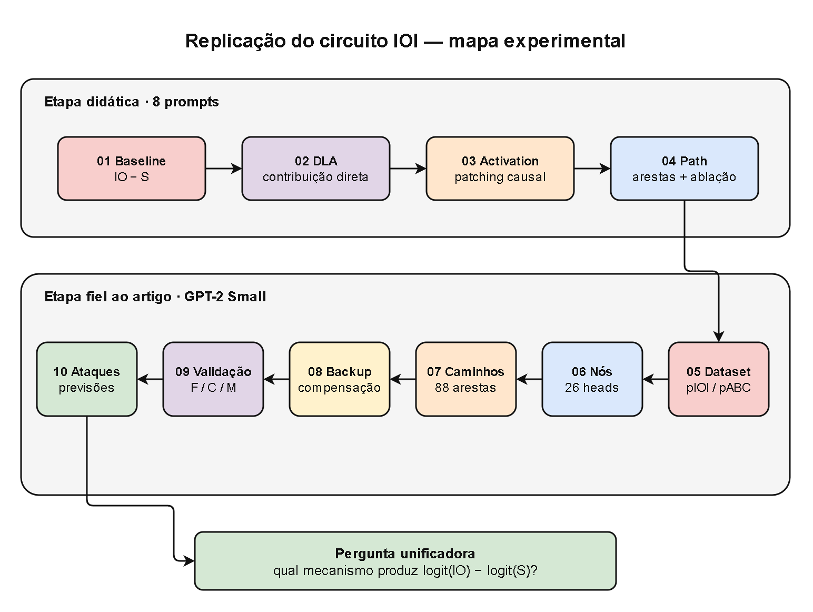
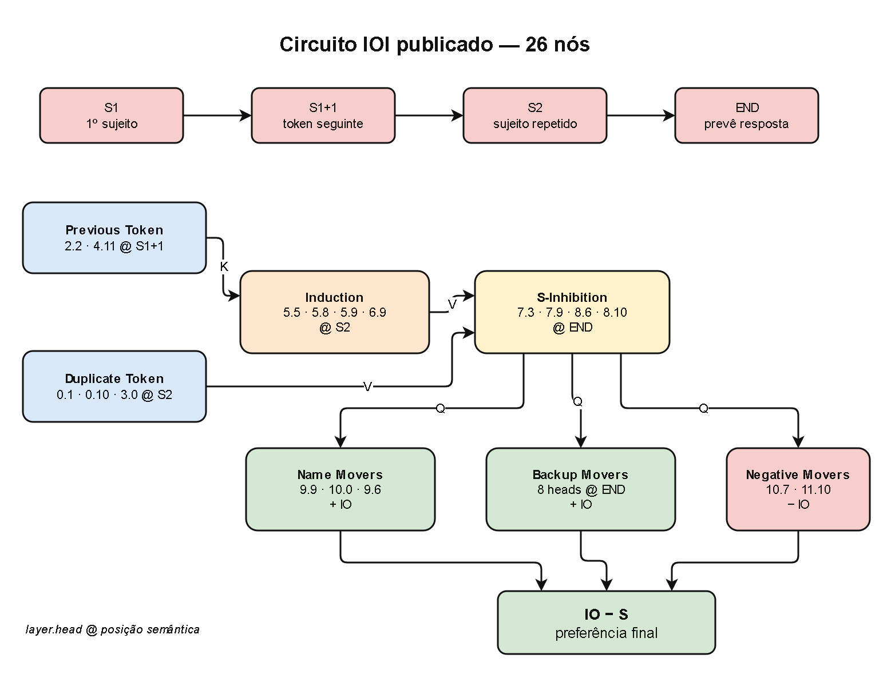
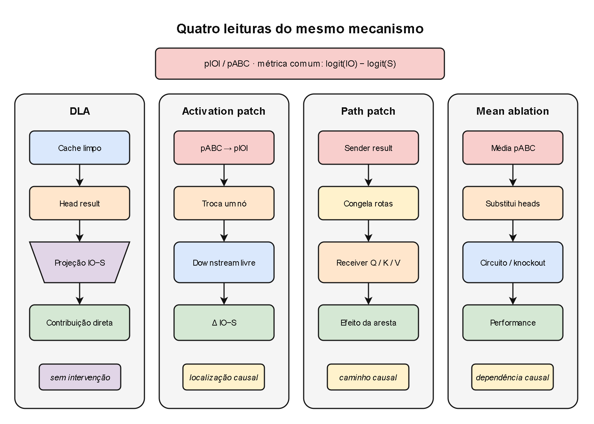
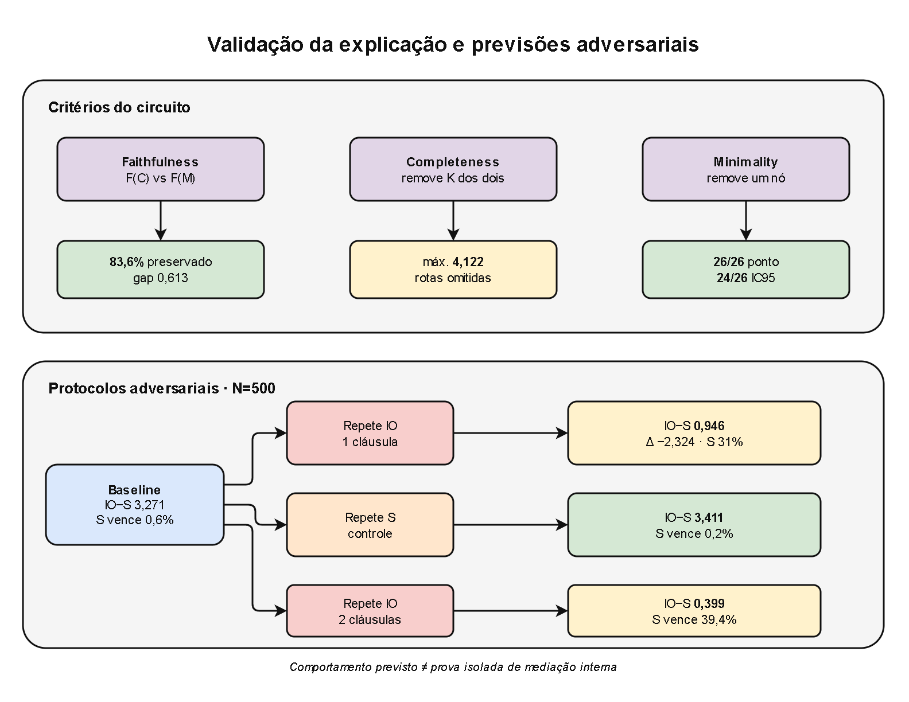

# Processo de estudo e reprodução do circuito IOI

[← Voltar à metodologia comum](../../docs/replicacoes/METODOLOGIA.md)

> **Estado:** concluído, com reprodução parcial dos resultados centrais
>
> **Última atualização:** 10 de novembro de 2026

## Síntese acadêmica

### Contexto

A interpretabilidade mecanística investiga como operações internas de uma rede
neural produzem um comportamento observável. Neste estudo, o caso analisado é a
tarefa de identificação do objeto indireto (*Indirect Object Identification*,
IOI) em GPT-2 Small. O trabalho de referência, Wang et al.,
[*Interpretability in the Wild*](https://arxiv.org/abs/2211.00593), propõe um
circuito de 26 cabeças de atenção, distribuídas em sete classes funcionais,
para explicar como o modelo escolhe o nome correto em frases como “Maria e João
foram à loja; João deu um presente para...”.

Escolhi começar por esse trabalho porque ele me dava algo que eu conseguia
acompanhar de ponta a ponta: uma tarefa comportamental clara, componentes
internos nomeados e experimentos causais que ligam esses componentes à
resposta. Isso me permitiu aprender as ferramentas ao mesmo tempo em que
avaliava uma explicação mecanística publicada.

### Problema de pesquisa

A pergunta central desta replicação é: **o circuito IOI publicado mantém poder
explicativo e causal quando reconstruído localmente, com dados, posições
semânticas, intervenções e métricas explicitamente controlados?** A hipótese é
apoiada quando o circuito preserva grande parte do desempenho do modelo,
quando seus nós e caminhos respondem às intervenções previstas e quando as
previsões adversariais do trabalho original reaparecem. Proximidade numérica
isolada não basta: atribuição, necessidade causal, suficiência e preservação
respondem a perguntas diferentes.

### Métodos

A investigação foi dividida em dois trilhos. Os notebooks 01–04 formam uma
introdução didática com oito prompts e apresentam linha de base, atribuição
direta aos logits, *activation patching* e *path patching*. Os notebooks 05–10
constituem o trilho de maior fidelidade: usam pares determinísticos
$p_{IOI}/p_{ABC}$, tokenização sem BOS artificial, posições semânticas e o
circuito publicado. Esse trilho avalia o baseline, diagnostica os 26 nós,
reconstrói caminhos com o algoritmo histórico de quatro passes, testa a
compensação das *Backup Name Movers*, mede *faithfulness*, *completeness* e
*minimality* e executa protocolos adversariais. Os tamanhos variam por
experimento, de N=16 nos prompts-alvo de compensação a N=500 na avaliação
adversarial; todos estão registrados nos artefatos canônicos.

### Resultados

Na linha de base fiel, o modelo obteve diferença média de logits IO−S de 3,644,
acurácia de 98,83% e probabilidade média de 52,02% para o nome correto
(N=256). O circuito reteve 83,6% do desempenho do modelo, com diferença
absoluta de 0,613 e IC95 de 0,348–0,878. Todos os 26 nós superaram o limiar de
1% na estimativa pontual de *minimality*, mas apenas 24 mantiveram o limite
inferior do IC95 acima desse limiar. No protocolo adversarial de repetição do
objeto indireto, a mudança IO−S foi −2,324, próxima da mudança −2,32 reportada
no artigo, embora resultados absolutos tenham divergido. Assim, a replicação
recupera parte importante do padrão comportamental e causal, mas não justifica
uma declaração de reprodução exata.

### Contribuição para o TCC

Para o meu TCC, este estudo funciona como referência de uma replicação de
circuito relativamente completo. Ao reconstruí-lo, aprendi na prática que
atribuir um logit a um componente, localizar uma ativação importante e
demonstrar necessidade causal não são a mesma coisa. O percurso parte de um
comportamento conhecido, intervém em componentes internos, testa o circuito
como conjunto e confronta uma previsão adversarial. Também me mostrou por que
resultados mecanísticos precisam vir acompanhados das definições das métricas,
dos controles, da incerteza e dos desvios de implementação, e não apenas de
estimativas numericamente próximas.

Organizei este projeto para permitir duas leituras complementares. Os notebooks
[01–04](notebooks/) formam um laboratório didático: oito prompts curtos tornam
visíveis a métrica, a decomposição e as intervenções. Os notebooks 05–10
recomeçam o experimento com as convenções de *Interpretability in the Wild*
([arXiv:2211.00593](https://arxiv.org/abs/2211.00593)): datasets pareados
$p_{IOI}/p_{ABC}$, posições semânticas, o circuito publicado e protocolos de
validação. O primeiro trilho ensina a fazer as perguntas; o segundo controla
dados, posições, intervenções e proveniência para respondê-las de modo mais
fiel ao artigo.

Os notebooks do trilho fiel são **independentes em dados**. Cada um constrói
seu próprio conjunto com tamanho e seed registrados, em vez de receber em
memória o dataset ou o resultado do notebook anterior. A ordem 05→10 é uma
ordem conceitual e operacional do
[runner](scripts/run_paper_notebooks.py), não uma dependência dos dados: ele
executa os arquivos em sequência, interrompe no primeiro erro, grava tempos e
status e só então reconstrói o índice consolidado.



## A passagem do trilho didático ao trilho fiel

Há cinco mudanças de contrato que impedem comparar os dois trilhos como se
fossem apenas versões de tamanhos diferentes:

| Convenção | Notebooks 01–04 | Notebooks 05–10 |
|---|---|---|
| População | 8 prompts compactos e fixos | datasets determinísticos $p_{IOI}/p_{ABC}$, com ABBA/BABA, templates e seeds próprios por experimento |
| Início da sequência | `prepend_bos=True` | `prepend_bos=False`: nenhum BOS artificial ocupa a posição 0, preservando sem deslocamento as coordenadas históricas do texto |
| Posição da previsão | `logits[:, -1]`, válido porque os 8 prompts terminam imediatamente antes da resposta | `positions["END"]` reunido linha a linha; o token IO da resposta pode já estar em `END+1`, e `-1` pode apontar para essa resposta ou para padding |
| Contraste causal | corrupção por troca IO/S entre pares de prompts | substituição $p_{ABC}$: IO, S1 e S2 recebem três nomes novos, preservando template e alinhamento |
| Métrica de intervenção | *recovery* normalizada entre baseline corrompida e limpa | diferença bruta IO−S em `END` e efeitos `patched − baseline`, salvo quando o artefato define outra razão específica |

Assim, `END` não significa “última coluna do tensor”: é a posição semântica
que prevê a resposta, localizada separadamente em cada exemplo. Nos datasets
do trilho paper, a última posição real pode ser o próprio token IO da resposta,
em `END+1`; nesse caso, `logits[:, -1]` já prevê o token posterior à resposta
e está errado mesmo sem padding. Quando há padding à direita, `-1` pode ainda
selecionar padding. O uso de `prepend_bos=False` completa esse contrato: sem um
BOS artificial reservado no índice 0, IO, S1, S2, S1+1 e END permanecem nas
coordenadas históricas da tokenização, em vez de serem deslocados em uma
posição.

Do mesmo modo, um efeito negativo no notebook 07 não é um *recovery* negativo
do trilho didático; é perda de IO−S ao inserir no forward de $p_{IOI}$ uma
escrita vinda de $p_{ABC}$.



## Caderno de bordo: pergunta, operação e evidência

### 01 — Baseline de IOI

**Pergunta.** O GPT-2 Small prefere o objeto indireto correto ao sujeito
repetido nos oito exemplos introdutórios? **Operação.** Tokeniza com BOS,
compara na última posição os logits dos dois nomes e confere a implementação
com indexação manual. **Evidência.** O próprio
[notebook 01](notebooks/01_ioi_baseline.ipynb) registra a diferença por prompt,
a média e as asserções de concordância. Ele estabelece comportamento, não
mecanismo, e não gera um JSON do trilho paper.

### 02 — Direct Logit Attribution

**Pergunta.** Quais componentes escrevem diretamente na direção
`correto − incorreto`? **Operação.** Reconstrói o baseline após `ln_final`,
decompõe o residual e projeta resultados de heads na direção de unembedding;
em seguida inspeciona as Name Movers publicadas 9.9, 9.6 e 10.0. **Evidência.**
Os mapas e verificações do
[notebook 02](notebooks/02_direct_logit_attribution.ipynb) mostram atribuição e
atenção END→IO. É evidência decompositiva, não de necessidade causal.

### 03 — Activation patching

**Pergunta.** Onde restaurar uma ativação limpa recupera o comportamento
degradado pela troca IO/S? **Operação.** Executa limpo e corrompido, transplanta
`resid_pre` ou saídas de heads e mede
$(patched-corrompido)/(limpo-corrompido)$. **Evidência.** Os mapas de residual,
o sweep de heads e os testes dos extremos 0/1 estão no
[notebook 03](notebooks/03_activation_patching.ipynb). A intervenção localiza
causalidade sob essa corrupção, sem ainda isolar arestas.

### 04 — Path patching e validação didática

**Pergunta.** Por quais receivers as heads candidatas afetam a resposta, e o
circuito proposto preserva o comportamento nesses oito prompts? **Operação.**
Separa sender e receiver, testa caminhos e aplica versões simplificadas de
faithfulness, completeness e minimality ao circuito publicado. **Evidência.**
Mapas de arestas, ablações de grupos e resultados do
[notebook 04](notebooks/04_path_patching_and_validation.ipynb). São validações
didáticas específicas aos oito prompts; o protocolo mais próximo do artigo só
aparece no notebook 09.



A figura aproxima as famílias de perguntas — atribuição, patching e validação
—, não suas convenções exatas. No trilho didático elas operam sobre oito
prompts, corrupção IO/S e *recovery* normalizada; no trilho paper usam posições
semânticas, substituição pABC e, em geral, IO−S bruto.

### 05 — Dataset do paper e baseline

**Pergunta.** O comportamento de IOI reaparece quando se adotam o dataset e as
coordenadas históricas? **Operação.** Constrói pares determinísticos
$p_{IOI}/p_{ABC}$, valida nomes single-token, grupos `(pattern, template_id)` e
as posições IO, S1, S2, S1+1 e END; mede IO−S, acurácia e P(IO) em minibatches.
**Evidência.** O [notebook 05](notebooks/05_paper_dataset_and_baseline.ipynb)
produz [o artefato de baseline](results/paper/baseline_seed_42_n_256.json), que
registra configuração, incerteza e comparação com o artigo. Este notebook
inicia de fato o trilho fiel; os posteriores não reutilizam seu lote.

### 06 — Validação diagnóstica do circuito publicado

**Pergunta.** As sete classes e os 26 nós já publicados exibem os sinais
esperados sob DLA e patching semântico? **Operação.** Projeta `hook_result`,
trata apenas END como atribuição direta, e substitui ativações
$p_{ABC}\rightarrow p_{IOI}$ nas cinco posições semânticas. **Evidência.** O
[notebook 06](notebooks/06_circuit_discovery.ipynb) e seu
[JSON](results/paper/06_circuit_discovery.json) guardam baseline, mapas e
resumos por classe. Apesar do nome histórico do arquivo, **06 é validação
diagnóstica da lista publicada, não descoberta cega do circuito**.

### 07 — Path patching fiel

**Pergunta.** As arestas dirigidas entre Duplicate/Induction, S-Inhibition e
Name Movers transportam o efeito nas posições semânticas previstas?
**Operação.** O método primário reproduz o algoritmo histórico de **quatro
passes**, com MLPs livres e congelados, para intervenções em S2 ou END e para a
grade de arestas publicada. O helper moderno do TransformerLens, que injeta a
diferença do write em Q/K/V em todas as posições, fica como diagnóstico
separado e não equivalente. **Evidência.** O
[notebook 07](notebooks/07_path_patching.ipynb) e o
[artefato de path patching](results/paper/07_path_patching.json) preservam os
dois métodos em campos distintos; o
[resumo canônico](results/paper/summary.json) declara
`historical_four_pass_semantic` como método primário.

### 08 — Backup Name Movers

**Pergunta.** As Backup Name Movers aumentam sua escrita quando as três Name
Movers primárias sofrem knockout? **Operação.** Substitui em END os resultados
primários por médias de uma referência pABC balanceada e independente, mede
DLA, atenção e mudança de escrita das backups em escala basal, separando o
efeito da reescala final. **Evidência.** O
[notebook 08](notebooks/08_backup_name_movers.ipynb) e seu
[JSON](results/paper/08_backup_name_movers.json) registram estimativas por
prompt e a fração de compensação. O denominador corrigido é a **DLA basal das
primárias menos a DLA das substituições pABC**, ambas na escala basal; não se
usa apenas a DLA basal como se toda ela tivesse sido removida.

### 09 — Faithfulness, completeness e minimality

**Pergunta.** Quanto do comportamento o circuito retém, o que acontece ao
remover o mesmo conjunto $K$ do modelo e do circuito, e cada nó é necessário
nos contextos históricos? **Operação.** Avalia as três definições com
diferenças pareadas e ablação `head@posição`, usando uma **referência pABC
balanceada e independente** apenas para as médias de substituição. A busca
gulosa segue o código histórico: amostra candidatos e aceita somente melhorias
estritas; isso também registra que a linha 4 do pseudocódigo do **Algorithm 3**
contém um erro. **Evidência.** O
[notebook 09](notebooks/09_faithfulness_completeness_minimality.ipynb) e o
[artefato de validação](results/paper/09_faithfulness_completeness_minimality.json)
guardam $F(M)$, $F(C)$, conjuntos removidos, curvas e intervalos. As contagens
pontual e com IC95 devem permanecer separadas.

### 10 — Protocolos adversariais

**Pergunta.** A previsão comportamental do circuito resiste a cláusulas que
repetem IO, em comparação com um controle que repete S? **Operação.** Parte de
prompts-base comuns, executa `paper IO single`, `paper S control` e
`advex double IO`, e recalcula todas as posições após a inserção. O desvio
deliberado em relação ao `advex.py` é **retokenizar o texto completo sem BOS**,
eliminando a mistura histórica de coordenadas. Os protocolos **single** e
**double** ficam separados; double IO não recebe um alvo inventado da Fig. 8.
**Evidência.** O [notebook 10](notebooks/10_adversarial_examples.ipynb) e o
[JSON adversarial](results/paper/10_adversarial_examples.json) registram
resultados absolutos, deltas pareados, seeds e hashes dos datasets.



## Fontes canônicas e proveniência

Para números consolidados, configurações e caminhos dos artefatos, a fonte
canônica é [`results/paper/summary.json`](results/paper/summary.json). Ele é
derivado dos seis JSONs do trilho fiel; não deve ser atualizado por cópia
manual. Para saber o que realmente foi executado, em qual ordem, dispositivo,
commit, duração e status, a fonte canônica é
[`results/paper/execution_manifest.json`](results/paper/execution_manifest.json).
Este documento não repete as tabelas extensas do [README](README.md):
resultados detalhados devem ser lidos nesses JSONs e nos notebooks que os
produziram.

O manifest registrado mostra uma execução CUDA bem-sucedida dos notebooks
05–10 em uma NVIDIA GeForce RTX 3050. Os tempos observados foram, na ordem,
25,531 s; 827,213 s; 562,182 s; 35,056 s; 800,455 s; e 36,518 s. São tempos
daquela execução, não estimativas universais. **Peak VRAM não foi
instrumentada**; portanto, não há valor de pico a declarar ou inferir.

## Limites de interpretação

Os resultados dependem da versão do modelo e do TransformerLens, das seeds, do
recorte de templates, da referência de ablação e do tamanho amostral. Os Ns
canônicos registrados são `N=256` no notebook 05, `N=64` em 06, `N=64` em 07,
**`N_target=16` e `N_ref=300` em 08**, `N_target=100` e `N_ref=300` em 09, e
`N=500` em 10. Em particular, a leitura de compensação de 08 é principalmente
causal e qualitativa por partir de apenas 16 prompts-alvo.

Os notebooks 01–04 ensinam o método, mas não produzem estimativas em escala de
paper. O notebook 06 parte dos nós publicados. Os dois algoritmos comparados em
07 não são intercambiáveis. Em 08–09, a referência pABC independente é um
desvio controlado do uso histórico do mesmo lote. Em 10, o recorte adversarial
e a retokenização corrigida precisam acompanhar qualquer comparação com a
Fig. 8.

Sinais ou rankings inesperados em amostras finitas não refutam sozinhos o
circuito. DLA, patching, compensação, faithfulness e desempenho final respondem
a perguntas diferentes; aproximar seus números sem preservar a definição da
métrica apaga justamente a distinção causal que o projeto pretende estudar.

## Como reproduzir

Partindo de `projects/ioi`, prepare o ambiente e o kernel:

```powershell
uv sync
uv run python -m ipykernel install --user --name ioi-replication --display-name "Python (IOI Replication)"
```

Execute testes e verifique que o resumo ainda deriva dos artefatos:

```powershell
uv run pytest -v
uv run python scripts/build_paper_summary.py --check
```

Para executar um notebook isolado:

```powershell
uv run jupyter nbconvert --to notebook --execute --inplace notebooks/<nome>.ipynb --ExecutePreprocessor.kernel_name=ioi-replication --ExecutePreprocessor.timeout=7200
```

Para refazer todo o trilho fiel em ordem e reconstruir os JSONs:

```powershell
uv run python scripts/run_paper_notebooks.py
```

O runner verifica o status Git do **repositório inteiro**, não apenas os
arquivos de `projects/ioi`, exige CUDA por padrão e recusa uma árvore
inicialmente suja. Antes da sequência, ele instala o kernel de usuário; durante
a sequência, o `nbconvert --inplace` atualiza os próprios notebooks com as
novas saídas. Uma execução intencional em CPU requer `--allow-cpu`; uma
execução intencional com alterações locais requer `--allow-dirty` e ficará
marcada como tal no manifest. Essas opções mudam a condição de reprodução e
não devem ser usadas para disfarçar diferenças de ambiente.

## Caminho de estudo recomendado

Leia 01→03 em sequência para formar a intuição “comportamento → atribuição →
intervenção”. Use 04 como ensaio do vocabulário de caminhos e validação. Em
seguida, trate 05 como uma reinicialização das convenções: confira primeiro
$p_{IOI}/p_{ABC}$, `prepend_bos=False` e END semântico. Só então avance para
06→08, acompanhando a figura do mecanismo, e feche com 09→10, onde a hipótese
do circuito é avaliada como conjunto e como previsão adversarial.

Para reprodução automatizada, a ordem é a mesma, mas a leitura dos resultados
deve terminar nos dois registros canônicos: `summary.json` responde “o que foi
observado?” e `execution_manifest.json` responde “o que de fato foi
executado?”.
