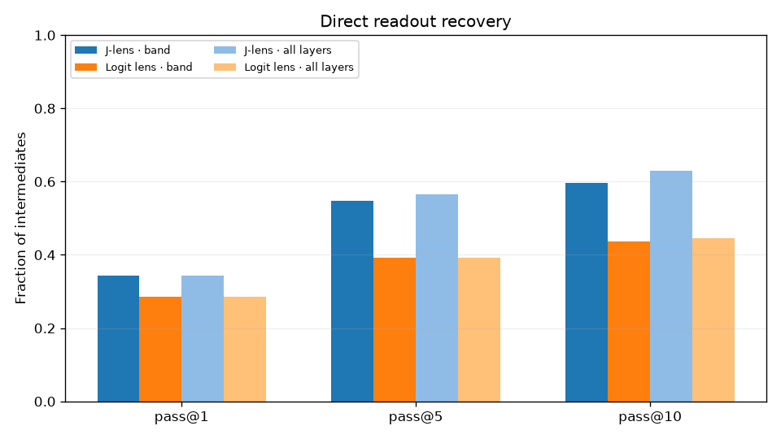
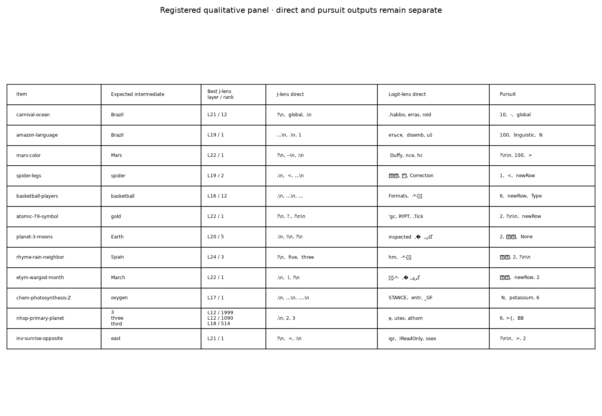
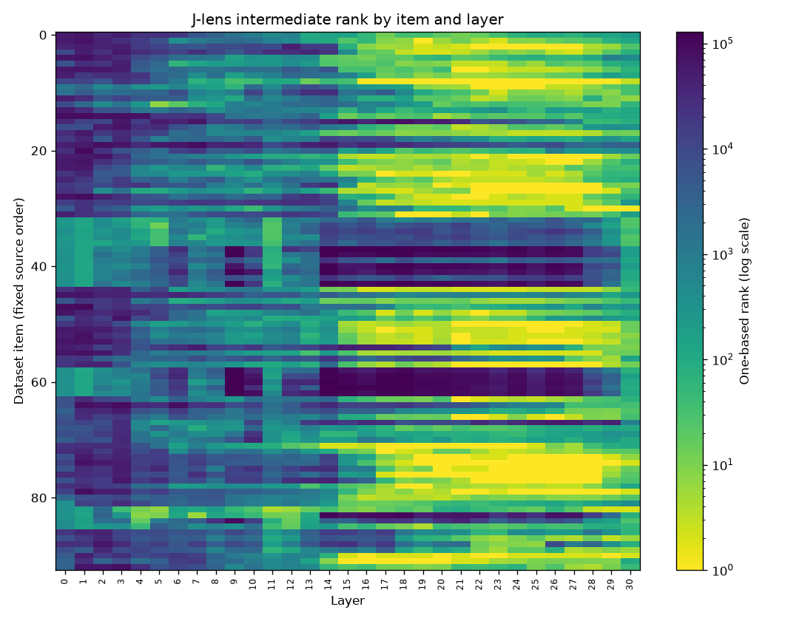

# Processo de estudo causal e observacional do J-space

[← Voltar à metodologia comum](../../docs/replicacoes/METODOLOGIA.md)
[← Voltar ao diário central dos experimentos](../../docs/ACOMPANHAMENTO_EXPERIMENTOS.md)

> **Estado:** tentativa causal inconclusiva preservada; avaliação da J-lens em
> 93 prompts executada e validada
>
> **Última atualização:** 11 de novembro de 2026

## Síntese acadêmica

### Contexto

O artigo da Anthropic
[*A global workspace in language models*](https://www.anthropic.com/research/global-workspace)
descreve o J-space como um espaço interno no qual conceitos relevantes para o
raciocínio corrente podem ser lidos e manipulados. A técnica usa uma
*Jacobian lens* (J-lens) para relacionar estados internos do modelo a conceitos
interpretáveis. O resultado mais forte não é apenas correlacional: em
experimentos do trabalho original, alterar um conceito intermediário modifica
a resposta posterior do modelo, sugerindo uso causal da representação.

Escolhi investigar se um marco causal mínimo desse tipo poderia ser
transferido para um modelo aberto menor, o
`meta-llama/Llama-3.1-8B-Instruct`, usando uma J-lens já ajustada e publicada
para esse modelo. Depois de trabalhar com circuitos e direções residuais, quis
dar um passo em direção a intervenções sobre conceitos intermediários. Minha
proposta não é reproduzir toda a análise da Anthropic, mas testar a cadeia
mínima “ler um conceito → intervir nele → observar uma mudança específica na
resposta”.

### Problema de pesquisa

A pergunta central é: **uma representação intermediária associada a `spider`
pode ser identificada no J-space do Llama 3.1 8B Instruct e causalmente
redirecionada para `ant`, alterando a resposta de oito para seis pernas sem
degradar a geração?**

A hipótese seria apoiada se quatro condições ocorressem conjuntamente:

1. o modelo sem intervenção respondesse oito;
2. o readout da J-lens identificasse `spider`;
3. a troca `spider → ant` produzisse uma resposta única equivalente a seis,
   sem simplesmente revelar a palavra `ant`;
4. o no-op e a perturbação aleatória pareada não produzissem o mesmo
   redirecionamento.

Falha de download, ausência de autorização, incompatibilidade da lente,
baseline inválida ou proveniência incompleta tornam a execução inconclusiva.
Essas condições não constituem evidência negativa sobre J-space.

### Métodos

O experimento foi projetado para o prompt principal “The animal that spins
webs has this many legs:” e duas paráfrases. A geração é determinística
(`do_sample=false`), limitada a 12 novos tokens e executada com seed 42. A
J-lens pré-ajustada
`llama3.1-8b-it/jlens/Salesforce-wikitext/Llama-3.1-8B-Instruct_jacobian_lens.pt`
é carregada do repositório `neuronpedia/jacobian-lens`; uma lente nova não é
treinada.

Quatro condições usam exatamente os mesmos prompts e parâmetros:

- **baseline:** modelo sem hooks;
- **no-op:** troca `spider → spider`, para detectar efeitos da
  instrumentação;
- **controle aleatório:** direção ortogonal aleatória pareada pela norma;
- **intervenção-alvo:** clamp causal `spider → ant` durante o *prefill*.

O readout e as intervenções são limitados em memória para permitir execução em
uma NVIDIA L4. O parser aceita apenas respostas inequívocas equivalentes a
oito ou seis e rejeita negação, conflito, qualificação, repetição, incoerência
e vazamento explícito do conceito-alvo. Os artefatos públicos armazenam apenas
métricas compactas e proveniência; prompts renderizados, continuações e
diagnósticos detalhados permanecem fora do Git.

### Resultados

A primeira tentativa, `a116c3da-bb8f-4a31-a39a-4fd09dd6fcad`, terminou antes
da inferência por falta de autorização para acessar o modelo. Depois da
aprovação, executei novamente o protocolo. A execução canônica atual,
`20eabeef-17f5-49dc-a4a1-fcafc20a9533`, carregou o Llama e a J-lens, verificou
a integridade da lente, realizou o readout e executou baseline, no-op, controle
aleatório e intervenção-alvo nos três prompts.

O estado final permaneceu `inconclusive`, com o código
`primary_gates_failed`. No prompt principal, o parser restrito não identificou
uma resposta única equivalente a oito no baseline nem no no-op. O readout foi
avaliado, mas `spider` não apareceu. O controle aleatório também não forneceu
uma resposta válida para o critério. Na condição-alvo, a troca não produziu
seis de forma válida, revelou `ant` na continuação e apresentou repetição. As
duas paráfrases igualmente não passaram pelos critérios.

Portanto, o marco causal planejado não foi demonstrado por este protocolo.
Também não interpreto a execução como uma refutação geral do J-space: a linha
de base comportamental exigida não foi estabelecida e o conceito-fonte não
apareceu no readout. O resultado científico adequado é que esta configuração
de prompt, parser, lente, camadas e `alpha=4.0` permaneceu
[inconclusiva](results/final_evaluation.json).

### Extensão observacional: avaliação da J-lens em 93 prompts

Depois dessa tentativa, decidi separar duas perguntas que o primeiro protocolo
misturava na prática: “o que a lente consegue expor?” e “uma direção exposta
tem efeito causal sobre a resposta?”. A avaliação seguinte trata apenas da
primeira. Ela foi implementada para mapear leituras internas de forma mais
ampla antes de formular outra intervenção e foi executada no runtime remoto
sem selecionar uma hipótese causal nova.

Os 93 prompts vieram da avaliação `lens-eval-multihop` do repositório da
Anthropic
[`anthropics/jacobian-lens`](https://github.com/anthropics/jacobian-lens), na
revisão fixada `581d398613e5602a5af361e1c34d3a92ea82ba8e`. Mantive apenas esse
arquivo de avaliação, com SHA-256
`2cd5a47aa3d7627708843bc61f03ab1d10eda4184f357c5cbf93c97184e32c9c`, e a
[licença Apache 2.0](data/anthropic-jlens/LICENSE) que acompanha a cópia local.

Cada item contém um `prompt`, um `target` e conceitos intermediários esperados.
O código fornece ao modelo somente o `prompt` bruto, exatamente como texto,
sem *chat template*. Essa escolha preserva a distribuição da avaliação e a
posição de leitura original: o prompt termina imediatamente antes do
`target`, e a lente lê a posição final. O `target` é metadado de avaliação e
auditoria; ele não é concatenado ao texto de entrada nem revelado ao modelo.

A avaliação compara três leituras que cumprem papéis diferentes:

- **J-lens direta:** aplica a lente com o ajuste do Jacobiano e mede o rank de
  cada conceito intermediário na posição final do prompt;
- **logit lens:** repete o mesmo ranking sem o ajuste do Jacobiano, oferecendo
  uma comparação direta nos mesmos prompts e camadas;
- **`gradient_pursuit`:** decompõe a ativação residual observada em direções do
  dicionário para um painel qualitativo registrado de 12 prompts. É uma
  leitura esparsa separada; seus coeficientes não são ranks da J-lens.

Nenhuma dessas rotas gera uma continuação. A J-lens e a logit lens apenas
projetam estados já produzidos no *prefill*; o `gradient_pursuit` lê cópias das
ativações finais e não as escreve de volta no modelo. Portanto, este protocolo
não contém edição, clamp, troca de conceito ou qualquer outra intervenção
causal.

As métricas diretas são `pass@1`, `pass@5` e `pass@10`: para cada item, calculo
a fração dos intermediários cujo melhor rank fica dentro de `k` e depois tiro
a média entre os 93 itens. O cálculo é registrado tanto para a *band* de
workspace resolvida em runtime quanto para todas as camadas ajustadas da lente.
Ranks por camada e o painel fixo de 12 prompts completam o diagnóstico. Esses
resultados serão observacionais, inclusive quando mostrarem diferenças entre
métodos ou regiões da rede.

Também separei sucesso operacional de desempenho científico. O status
`success` exige 93 registros alinhados, auditoria de tokenização, painel
completo, escopos de camada coerentes, proveniência verificável, hashes e
figuras válidos. Ele não exige `pass@k` alto. Assim, uma execução completa com
recuperação baixa ainda pode ser publicada como operacionalmente bem-sucedida,
sem que isso demonstre um workspace útil ou um efeito causal.

### Resultados observacionais

A execução canônica `2fcb8a49-136f-4868-91cc-f98f9dc2e57d` começou em
`2026-11-11T15:14:19.427513Z` e terminou em
`2026-11-11T15:19:29.812212Z`. Em uma NVIDIA L4, com `bfloat16` e CUDA 13.2,
ela processou os 93 itens e terminou com `status=success`. Esse estado afirma
que o pipeline e a evidência foram completados e validados; não afirma que a
recuperação foi alta e não modifica o resultado causal anterior. O
[manifesto observacional](results/jspace_observation_manifest.json) registra
essa execução e sua proveniência.

Na *band* 12–28, a J-lens obteve `pass@1=0,344086`,
`pass@5=0,548387` e `pass@10=0,596774`; a logit lens obteve `0,284946`,
`0,392473` e `0,435484`. Quando permiti que o melhor rank viesse de qualquer
camada ajustada, 0–30, a J-lens passou a `0,344086`, `0,564516` e `0,629032`,
e a logit lens a `0,284946`, `0,392473` e `0,446237`. A J-lens recuperou uma
fração maior de intermediários neste recorte, mas essa comparação entre
projeções sobre os mesmos estados é observacional: ela não mostra que os
conceitos recuperados causem a resposta.

<figure>



<figcaption><em>Figura observacional: recuperação agregada das duas lentes nos dois escopos de camada.</em></figcaption>

</figure>

Dos 103 intermediários, 82 eram single-token e 21 eram multi-token. Os 82
single-token aparecem em 81 itens. Nesse subconjunto, os valores
`pass@1/5/10` na *band* foram `0,395062 / 0,641975 / 0,691358` para J-lens e
`0,333333 / 0,456790 / 0,506173` para logit lens. Em todas as camadas, foram
`0,395062 / 0,654321 / 0,716049` e
`0,333333 / 0,456790 / 0,518519`, respectivamente. A diferença em relação ao
conjunto total sugere que a tokenização participa da dificuldade medida; não
autoriza generalizar para outros tokenizers, lentes ou corpora.

Não auditei apenas o primeiro token de cada intermediário. Também registrei
os IDs e os hashes da tokenização bruta dos 93 prompts. O readout confere se
a tokenização interna da lente coincide com essa auditoria, e o painel
reutiliza os mesmos IDs ao capturar a posição final. Isso fecha uma fonte de
divergência silenciosa entre duas leituras do mesmo texto.

O painel fixo de 12 itens mostra tanto recuperações claras quanto falhas.
`Brazil` em `amazon-language`, `Mars`, `gold`, `March`, `oxygen` e `east`
chegaram ao rank 1 da J-lens. `spider`, no item `spider-legs`, teve melhor
rank 2 na camada 19, tanto na *band* quanto no conjunto completo. Já
`nhop-primary-planet` foi difícil: na *band*, `3`, `three` e `third` tiveram
ranks 1999, 1090 e 514; a busca em todas as camadas melhorou esses valores
para 24, 286 e 349, sem torná-los recuperações fortes.

<figure>



<figcaption><em>Figura observacional: painel qualitativo registrado, com recuperações e falhas.</em></figcaption>

</figure>

No heatmap, as primeiras camadas concentram ranks altos para a maioria dos
itens. Há uma melhora ampla a partir da região intermediária e uma
concentração qualitativa de ranks menores entre aproximadamente as camadas 17
e 28, mas permanecem faixas de itens ruins nessa mesma região; as camadas 29 e
30 também são heterogêneas. Como cada célula usa o menor rank entre os
intermediários daquele item, a figura não localiza uma camada causal nem
garante que todos os conceitos do item estejam disponíveis.

<figure>



<figcaption><em>Figura observacional: distribuição dos melhores ranks por item ao longo das camadas.</em></figcaption>

</figure>

O `gradient_pursuit` às vezes reencontra o texto esperado. No caso de
`spider`, ele inclui `Spider` ou `spider` entre os componentes em várias
camadas, chegando ao segundo componente na camada 24, enquanto o ranking
direto da J-lens encontra rank 2 na camada 19. Essa proximidade é útil como
checagem qualitativa, não como igualdade: o ranking direto ordena tokens
projetados pela lente, enquanto o pursuit aproxima uma ativação com uma
combinação esparsa e reporta coeficientes e variância explicada. Há também
casos em que o intermediário não aparece entre os componentes registrados,
como `basketball` e `Spain`, embora o ranking direto ainda possa localizá-lo.

As três figuras são coerentes com as métricas versionadas, a ordem dos itens
e os ranks destacados. O gráfico de `pass@k` e o heatmap comunicam bem seus
agregados. O painel, porém, imprime tokens brutos: quebras de linha, glifos de
outros scripts e fragmentos como `newRow` reduzem a legibilidade de várias
células. Não interpreto esse ruído visual como conteúdo semântico e uso as
métricas validadas como fonte numérica.

### Contribuição para o TCC

Mesmo inconclusivo, este estudo tem uma função metodológica importante no meu
TCC. A primeira tentativa me obrigou a separar falha de infraestrutura de
resultado experimental; a segunda mostrou outra distinção: executar a
intervenção não significa que as precondições científicas tenham sido
satisfeitas. Em conjunto com IOI e Refusal Direction, este estudo representa o
terceiro nível de análise causal que explorei: a intervenção sobre conceitos
em um espaço de trabalho aprendido por uma lente. Registrar o baseline
inválido, o readout sem `spider` e a degradação da intervenção evita transformar
uma execução completa em uma conclusão mais forte do que os dados permitem.
A avaliação da J-lens estende essa contribuição metodológica ao separar
exploração observacional de confirmação causal. Ela não reclassifica a
tentativa anterior e não fornece, por si só, evidência de que um conceito lido
seja usado pelo modelo para produzir a resposta.

## Trabalho de referência e implementação

- Artigo: Anthropic, [*A global workspace in language
  models*](https://www.anthropic.com/research/global-workspace).
- Código de referência da lente: [Anthropic
  `jacobian-lens`](https://github.com/anthropics/jacobian-lens).
- Pipeline usado localmente: [`haohww/jspace`](https://github.com/haohww/jspace),
  commit `04c822a255fe0a10d84e08ec499e5e09f4b7d37a`.
- Modelo: `meta-llama/Llama-3.1-8B-Instruct`, revisão resolvida
  `0e9e39f249a16976918f6564b8830bc894c89659`.
- Lente: `neuronpedia/jacobian-lens`, revisão resolvida
  `d2527c3cdbaa60dd4b65cbca1604921f044e989a`.

### Escopo e fidelidade

**Mantido:** uso de uma Jacobian lens, leitura de conceitos intermediários,
intervenção causal entre conceitos e exigência de mudança comportamental
específica.

**Adaptado:** modelo aberto de 8 bilhões de parâmetros, lente pré-ajustada,
apenas uma relação factual e uma GPU L4. A implementação usa o pacote
`jspace`, e não uma reprodução independente de todo o código do artigo.

**Fora do escopo:** ajuste da lente, múltiplos modelos e tarefas, geometria
global do workspace, reportabilidade ampla, ablações em escala, comparações
estatísticas e generalização do mecanismo.

## Desenho experimental

### Linha de base e readout

A linha de base é válida somente se o prompt principal produzir uma resposta
única equivalente a oito sem degradação. Em seguida, o readout deve avaliar
explicitamente se `spider` aparece nas camadas examinadas. A ausência dessa
condição impede interpretar uma troca causal posterior.

### Intervenção e controles

Para cada prompt e valor de `alpha`, as quatro condições são executadas sobre a
mesma tokenização. O no-op testa neutralidade dos hooks. O controle aleatório
é ortogonal e pareado pela norma com a alteração-alvo, para verificar se uma
perturbação genérica produz o mesmo efeito. A intervenção-alvo faz o clamp da
representação-fonte para a representação-alvo apenas no *prefill*, evitando
alterações sucessivas durante a geração autoregressiva.

O critério principal exige baseline e no-op com oito, intervenção-alvo com
seis, controle aleatório com uma resposta coerente diferente de seis, ausência
de vazamento de `ant` e ausência de degradação. As paráfrases são dados
secundários de transparência, não uma afirmação de generalização.

## Ambiente e proveniência observados

- GPU: NVIDIA L4.
- CUDA: 13.2.
- Dtype solicitado: `bfloat16`.
- Python: 3.13.16.
- PyTorch: 2.15.0.
- Transformers: 5.22.2.
- `huggingface_hub`: 2.4.0.
- Seed: 42.
- Commit local: `fd8a77ad7d93df76b5c499bb314a71ad1c75760c`.
- Estado do código-fonte no envio: limpo no escopo do experimento.
- Camadas: 12–28 no protocolo causal e como faixa principal da avaliação da
  J-lens; essa avaliação também reporta todas as camadas ajustadas da lente,
  0–30, em um modelo com 32 camadas.
- Lente: 1.040.197.778 bytes, SHA-256
  `d5300a1575c0b5ad6e01b098c75adb072f3a6c246f184ce2fb35a3550fc8c68b`.

O manifesto registra `provenance_complete=true`: modelo, lente, software,
hardware, prompts, camadas, intervenção e fonte foram medidos e vinculados à
execução.

## Execução e reprodução

### Protocolo causal preservado

O modelo é *gated*. Antes da execução, é necessário entrar no site do Hugging
Face com a mesma conta usada no CLI e aceitar ou solicitar acesso na
[página oficial do modelo](https://huggingface.co/meta-llama/Llama-3.1-8B-Instruct).
O comando `hf auth login` confirma identidade, mas não concede a licença. Nesta
execução, o acesso já estava aprovado e o download foi concluído.

Na raiz do repositório:

```powershell
python tools/colab/run_jspace.py probe
python tools/colab/run_jspace.py start --gpu L4
python tools/colab/run_jspace.py sync
python tools/colab/run_jspace.py bootstrap
python tools/colab/run_jspace.py auth-hf
python tools/colab/run_jspace.py execute --notebook projects/jspace_llama/notebooks/01_readout_and_causal_swap.ipynb --timeout 7200
python tools/colab/run_jspace.py fetch
python tools/colab/run_jspace.py stop
```

Depois de baixar os artefatos:

```powershell
Set-Location projects/jspace_llama
uv run python scripts/validate_results.py
uv run pytest -q
```

A sessão de GPU deve ser encerrada mesmo após erro ou queda da conexão local.

### Avaliação da J-lens em 93 prompts

A análise sem intervenção usa a mesma preparação de runtime, mas outro
notebook e um perfil de download separado. Na raiz do repositório:

```powershell
python tools/colab/run_jspace.py probe
python tools/colab/run_jspace.py start --gpu L4
python tools/colab/run_jspace.py sync
python tools/colab/run_jspace.py bootstrap
python tools/colab/run_jspace.py auth-hf
python tools/colab/run_jspace.py execute --notebook projects/jspace_llama/notebooks/02_observe_multihop_jspace.ipynb --timeout 7200
python tools/colab/run_jspace.py fetch --result-set observation
python tools/colab/run_jspace.py stop
```

O perfil `observation` baixa as métricas compactas e as figuras sem
sobrescrever os resultados causais. Um arquivo bruto, ignorado pelo Git, serve
só para a validação local recalcular hashes e conteúdo; ele não contém saídas
geradas. Para validar o conjunto:

```powershell
cd projects/jspace_llama
uv run python scripts/validate_observation.py
```

Na execução canônica, essa validação independente terminou com `PASS`. O
arquivo bruto continua fora da evidência versionada.

### O que a execução remota ensinou

Os problemas operacionais encontrados durante a execução também esclareceram
o que preciso controlar para chamar uma medição de reproduzível. No Colab, o
diretório corrente não é uma forma segura de descobrir a raiz sincronizada;
o runner precisa localizar a estrutura do projeto por marcadores e trabalhar
a partir dela. Isso evita que uma sessão iniciada em outro caminho use arquivos
ou ambiente errados sem perceber.

Também observei que o estado já importado do Matplotlib e de extensões nativas
pode sobreviver à atualização do ambiente dentro do mesmo processo. A
renderização das figuras em um processo isolado passou a separar a inferência
do estado gráfico persistente e a falhar de forma explícita se o renderizador
não estiver coerente. Essa separação importa porque uma figura produzida não é
evidência suficiente de que foi produzida pelo ambiente que o manifesto
declara.

O arquivo bruto da avaliação é naturalmente muito maior que as métricas
compactas. Os limites de tamanho no empacotamento e no transporte precisam,
portanto, ser específicos ao tipo de artefato: baixos demais rejeitam
evidência válida; altos e indiscriminados deixam de detectar saídas
acidentais. Por fim, a validação encontrou um falso positivo ao interpretar o
token legítimo `/x` como caminho. A correção foi tornar a checagem sensível ao
campo, em vez de procurar padrões suspeitos em qualquer string. A lição comum
é que reprodutibilidade depende tanto de rejeitar saídas indevidas quanto de
não rejeitar dados válidos por heurísticas genéricas.

A revisão integral ainda revelou que a primeira validação numérica do
`gradient_pursuit` criava uma máscara `isfinite` do tamanho inteiro do
dicionário em GPU. A L4 encerrou essa tentativa como `resource_exhausted`, sem
publicar artefatos parciais. Troquei a checagem por blocos limitados a um milhão
de elementos e repeti o protocolo em uma sessão limpa. A execução v2 então
terminou com `success`, preservando a rejeição de `NaN` e infinito sem exigir
uma segunda cópia do dicionário na memória.

Também passei a recomputar a proveniência do código a partir dos blobs do commit
histórico, e não apenas a confiar no hash declarado pelo produtor. O manifesto
canônico aponta para o commit `4cd9756786ee83dabc0d3340385919fd408cc549`
e para o digest de fonte
`0c7d97282d2d4c699a4c392d5efb6a9388dd9d8cee0b7b9d5f63e6dc7f8dc8e8`.

## Evidência canônica

- [Manifesto causal](results/execution_manifest.json): ambiente, revisões
  resolvidas, configuração e motivo terminal.
- [Avaliação causal](results/final_evaluation.json): estado científico
  agregado e campos explicitamente não avaliados.
- [Manifesto observacional](results/jspace_observation_manifest.json):
  proveniência e estado operacional da avaliação da J-lens.
- [Resultado observacional](results/jspace_observation.json): métricas, ranks,
  painel e resumo de tokenização.
- [Gráfico de pass@k](results/jspace_observation_pass_at_k.png): comparação
  agregada das duas lentes.
- [Heatmap de ranks](results/jspace_observation_rank_heatmap.png): ranks da
  J-lens por item e camada.
- [Painel qualitativo](results/jspace_observation_panel.png): 12 prompts
  registrados.

O artefato final registra um prompt principal, duas paráfrases e um valor de
`alpha` efetivamente avaliados. Nenhuma combinação passou por todos os
critérios primários. Esse resultado causal permanece byte a byte inalterado.
As figuras e métricas observacionais são uma evidência separada.

## Desvios e limitações

| Desvio ou limitação | Motivo | Impacto |
|---|---|---|
| Apenas um marco causal planejado | Restrição deliberada de escopo | Não replica a abrangência do artigo |
| Uma seed e um valor inicial de `alpha` | Experimento mínimo | Não permite estimar variabilidade ou sensibilidade |
| Lente pré-ajustada | Custo de ajuste e foco causal | Não valida o procedimento de treinamento da lente |
| Baseline sem resposta numérica válida | O prompt e o parser restrito não estabeleceram a precondição comportamental | Impede interpretar causalmente a falha da troca |
| `spider` ausente no readout | A lente não expôs o conceito-fonte nas camadas avaliadas | A intervenção não parte de uma representação-fonte validada |
| Vazamento de `ant` e repetição | A condição-alvo degradou a continuação em `alpha=4.0` | A mudança não pode ser tratada como redirecionamento factual limpo |
| TorchAudio incompatível no Colab | Pacote pré-instalado usava CUDA 13.0, enquanto PyTorch usava 13.2 | Exigiu remoção segura do pacote de áudio não utilizado antes da execução |
| Tokenizer e lente específicos | Tokenização do Llama e lente ajustada em Salesforce-Wikitext | Os ranks não generalizam automaticamente para outro vocabulário, corpus ou lente |
| *Band* 12–28 e camadas ajustadas 0–30 | Escopos disponíveis nesta lente e neste protocolo | A distribuição por camada não estabelece uma região universal de workspace |
| Painel fixo de 12 itens | Diagnóstico qualitativo registrado antes da execução | Exemplos bons ou ruins não estimam desempenho fora dos 93 itens |
| Painel visual com tokens brutos | A figura preserva fragmentos do tokenizer | Glifos e quebras de linha prejudicam leitura; valores devem vir das métricas versionadas |

Na avaliação da J-lens, o painel de 12 itens é deliberadamente qualitativo, e
a comparação entre *band* e todas as camadas continua observacional; nenhuma
delas mede efeito sobre a saída do modelo.

## Próximo passo científico

Uma confirmação causal futura deve começar por uma especificação nova, com
hipótese, prompts ainda não usados nesta avaliação, regras de parsing e controles
pré-declarados capazes de estabelecer uma linha de base inequívoca. A leitura
observacional pode motivar esse trabalho, mas não autoriza escolher
retrospectivamente, nesta documentação, um conceito, uma direção, uma camada
ou um `alpha` que pareça favorável. Também não separo agora prompts do conjunto
como *held-out*: isso faria parte da nova especificação, antes de qualquer
execução causal. Qualquer troca precisará de uma execução registrada própria.
